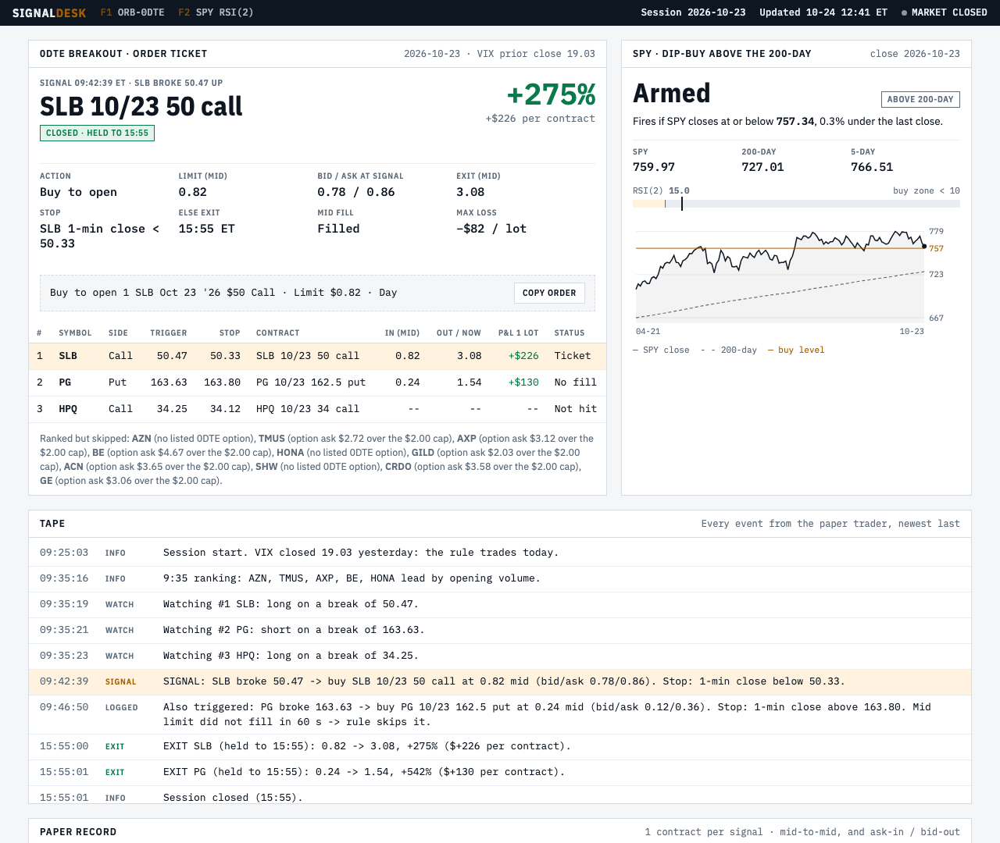

# futures-research-platform

**A research program for deciding when evidence is good enough to act on — and the daily options signal tool that came out of it.**

Two parts:

1. **`signals/` — a working daily signal tool.** Two pre-registered, out-of-sample-tested options rules, run from the
   command line on free market data. It paper-trades and logs real option quotes. It never places orders.
2. **The validation layer** (everything below *My role*): the futures research program that rejected 91.8% of the
   strategies it tested, and the tooling that decided which numbers to trust.



*The dashboard that opens when you start it. This is the 2026-10-23 paper session: SLB 50 call, +275%.*

---

## Quick start (5 minutes)

**Before you start:**
- Get a **free** [Alpaca](https://alpaca.markets) account: sign up → *Paper Trading* → *API Keys* → *Generate*. No money
  or brokerage account is needed; the keys only read market data.
- Install [Python 3.12](https://www.python.org/downloads/). On Windows, tick **"Add python.exe to PATH"**.

**Windows**
1. Click the green **Code** button above → **Download ZIP**, and unzip it.
2. Double-click **`install.bat`** and paste your two Alpaca keys when asked.
3. Double-click **`start.bat`** and leave the window open.

**Mac / Linux**: paste into Terminal, then paste your two Alpaca keys when asked:

```bash
git clone https://github.com/wgerhardstein/futures-research-platform.git && cd futures-research-platform && ./install.sh
./start.sh
```

That's it. Your browser opens the **Signal Desk** dashboard at `http://localhost:8321`, which runs only on your
computer. While the window is open, it runs by itself every weekday (US Eastern time):

| Time | What happens |
|---|---|
| 9:25 → 15:55 | 0DTE breakout session. At 9:35 the dashboard shows the day's stocks in play and the three names it is watching. When one breaks out, the **order ticket** shows the exact contract, the limit, the stop and a **Copy order** button with Webull-style text, ready to place yourself if you want to. |
| 15:50 | SPY dip-buy check. The dashboard always shows the price at which it would fire. |

Everything is also saved under `data/signals/`, including `run.log` and the paper-trade CSVs. The computer has to be on
and awake at those times.

**Other commands.** On Windows, run them from a terminal in the folder as `start.bat <command>`; on Mac/Linux,
`./start.sh <command>`.

| Command | Does |
|---|---|
| `dashboard` | Open the dashboard without the scheduler |
| `status` | Paper results so far against the backtest |
| `spy` | SPY signal right now (preview, changes nothing) |
| `orb --now` | Today's breakout ranking right now (after 9:35) |
| `check` | Re-test your keys and data access |

---

## The two rules

Full results, including what was tested and rejected: [`research/RESULTS.md`](research/RESULTS.md).

| | 0DTE opening-range breakout | SPY RSI(2) dip-buy |
|---|---|---|
| Source | Zarattini, Barbon & Aziz (2024) | Connors & Alvarez (2008) |
| Entry | Top relative-volume stock in the first 5 min; buy the same-day at-the-money option when price breaks the first 5-min candle | SPY above its 200-day average and 2-day RSI below 10, buy at the close |
| Exit | 1-min close beyond 10% of ATR14, else 15:55 | First close above the 5-day average |
| Filters | Skip if VIX > 20; option ask ≤ $2.00 | — |
| Frequency | Most trading days | About 8 trades a year |
| Evidence | +8.3% per trade where built (2024-26, real option prices); **+2.3% on an untouched holdout, confidence interval includes zero** | 263 trades since 1994, 76% winners, +0.63% per trade, beats 2,000 random-entry controls; ~45-day call version +8.9% per trade on real 2024-26 prices |
| Status | **Paper trading** since 2026-10-23 to verify fills | Paper trading |

**Not financial advice.** Both rules can lose money. The breakout rule in particular is unproven out of sample. Options
can go to zero, so size any real position so that a total loss is acceptable.

---

# The futures research program

I spent 2026 building and running a multi-strategy futures trading system. The
interesting part is not the trading. It is that the whole thing is organised
around one question: *how do I stop myself from believing a number that is not
real?*

The headline result is a rejection rate. Out of **8,179 candidate configurations
tested, 7,507 were thrown away** — 91.8%. Nine survived to run live.

Anyone can find something that looks profitable on historical data. The work is
discarding the ones that only look that way, and continuing to discard them when
you would rather not.

---

## My role

I designed and ran this research program:

- Chose the research direction and sourced every strategy candidate.
- Made every go/no-go call on what was deployed, shelved, or killed.
- Set the evidence standard the work had to clear — including the tests that
  killed results I wanted to keep.
- Rejected numbers that could not be re-derived from a source artifact,
  including in this README (see *Drift and invention* below).

Implementation is AI-assisted. I specify, direct and verify the build rather
than hand-writing it, which is the same division of labour I would expect
working alongside an engineering team.

---

## By the numbers

Every figure is regenerated from a source artifact, not transcribed. Where a
number could not be re-derived, it is not here.

| | |
|---|---|
| Candidate configurations evaluated | **8,179** |
| …rejected as indistinguishable from noise | **7,507 (91.8%)** |
| 1-minute bars analysed | **39,017,598** |
| Strategy books tested, trade by trade | **16** — 5,948 trades, 2021 → 2026 |
| Backtest span per strategy | **1,321 trading sessions** |
| Simulated account paths (position-sizing study) | **340,000** |
| Strategies formally graded for reproducibility | **50** |
| …that reproduce from a frozen specification today | **5** |
| Running live | **9 strategies**, 2 instruments, 18 account slots |
| Documentation | 88 dated decision documents over 397 commits |

---

## Four decisions, and why


### 1. I replaced a random sampler with an exhaustive count

The system originally estimated outcomes by simulating random samples. I
replaced it with a method that walks **every possible starting day** and counts
what happened. The result is not an estimate of the rate — it *is* the rate.

The reason was not precision. It was that the same strategy once produced two
very different results on two runs, and random variation between runs is
excellent camouflage for a bug. Once the process was deterministic, any
disagreement became immediately visible instead of looking like noise.

**The general point:** randomness in a measurement tool hides defects in the
thing being measured.

### 2. I found a deadline that was quietly 50% too generous

The accounts I trade have a 30-day deadline. The system was counting 30 *rows*
of trading-day data as 30 days. Trading days skip weekends, so 30 rows is about
45 real days — half again as much time as the account actually gets.

Every result was flattering, and nothing looked wrong. I rebuilt the data so
every calendar day is present, weekends included as zeros, which means a Friday
start now genuinely differs from a Monday start.

**The general point:** a deadline measured in rows rather than in time silently
grants extra runway. This generalises well past trading.

### 3. I killed my own best-scoring result

I ran a search to re-select which strategies belonged in the live book. I set
the success criteria **in advance**, and included two safeguards: a control, and
a test against randomly chosen books. The search produced a result that scored
**+7.4 points better than what I was running and beat 100% of the random
books.** It passed every gate I had set.

Then I tested it on a period it had never seen:

| | 2021-23 (seen) | 2024-26 (unseen) |
|---|---|---|
| the new book | 92.3% | **34.4%** |
| what I was already running | — | **68.8%** |

It was less than half as good as the thing it was replacing. It had not found a
better book, it had memorised the past.

The warning sign was visible before that test ran, and I had missed it: the
search had discarded **every single strategy that had independently passed
validation.** A search that throws away everything which survived scrutiny is
fitting noise, not finding signal.

I did not deploy it. **Pre-registering your criteria is necessary and not
sufficient** — only testing on time you have not seen catches this.

### 4. I stopped trusting two things that agree with each other

The live system and the research model were checked against each other and
agreed, which I treated as confirmation. It is not. They share a component, so
an error inside that component would be identical on both sides and the check
would report success forever.

Two things that agree share every assumption they hold in common. Confirming the
work required a third, independent implementation written by someone else.

**The general point:** agreement between two things is only evidence if they can
actually disagree.

---

## Drift and invention

The idea the whole system is organised around, and the one I would defend hardest.

- **Drift** is a claim that contradicts a source. Something can check for it.
- **Invention** is a plausible number that no source contradicts. Nothing can
  check for it, because there is nothing to check against.

The defence is to make numbers **derived rather than typed** — generated on
demand from the source, never edited by hand. Generating a claim is what turns
invention into drift, and drift is catchable.

This is not theoretical, and I will use this README as the example. An earlier
version of it claimed "193 sources mined." When I went to regenerate that number
before publishing, no artifact supported it — I could not tell you where it came
from. The same pass found a commit count that had been correct when written and
had since drifted. The first was invention, the second was drift. The first is
the more dangerous of the two, because nothing would ever have flagged it.

Every number in the table above was regenerated before this was published. The
one that could not be was removed.

---

## What is in the repository

**Here:** the options signal tool and the research behind it (in full), plus the futures program's scoring engine,
validation layer, risk controls, broker interface, and a data generator so the futures validation suite runs for
anyone who clones it.

**Not here:** the futures strategies themselves and their real trade data. A placeholder implements the same interface
and deliberately never trades, so the structure is legible without giving those away. The validation layer is
demonstrated against that placeholder, which has no edge.

```
signals/      daily options signal tool (orb = 0DTE breakout, spy_rsi2 = SPY dip-buy), local dashboard (web.py), CLI
research/     RESULTS.md + a free-data reproduction of the SPY rule
tests/        unit tests for the signal rules (no network)
engine/       the futures scoring model
validation/   controls, invariants, three independent external audits
execution/    broker interface, live session state, alerts, journalling
risk/         loss limits, drawdown floors, position limits
strategy/     placeholder implementing the private interface
synthetic/    data generator so the suite runs without private data
```

### Running the checks

```bash
pip install -r requirements.txt
python -m pytest tests/ -q                                  # signal rules (no network)
python -m synthetic.bars && python -m synthetic.generate   # futures validation layer on generated data
python -m pytest validation/ -q
python validation/test_controls.py
python -m research.spy_rsi2_backtest                        # reproduces the SPY rule's numbers (free data)
```

---

## What I would take to another domain

**Measure the noise before believing a difference.** Once I measured how much my
results moved for reasons unrelated to what I was testing, a week of
apparently-meaningful comparisons turned out to be indistinguishable from zero.
I had already made decisions on several of them.

**Agreement is not verification.** Two things that agree may share the same
error.

**Write down what you believed and when.** The decision log is how I can tell a
conclusion that survived scrutiny from one I simply never revisited. Twice it
caught me contradicting myself a day later.

**The dangerous files are the ones you already decided were safe.** Reviewing
this repository before publishing it, the real problems were both in files I had
cleared on an earlier pass.
